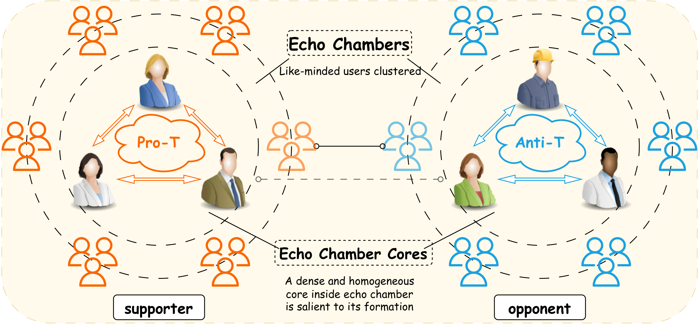

# On Echo Chamber Cores and Their Detection

<p align="center">
  
</p>

<p align="center">
  <a href="environment.yml"></a>
  <a href="src/pads.cpp"></a>
  <a href="LICENSE"></a>
  <a href="#datasets"></a>
  <a href="#datasets"></a>
</p>

Code for the paper *On Echo Chamber Cores and Their Detection*. It finds the nucleus of an echo chamber, grows that nucleus into the surrounding chamber, and uses it as a target for polarization mitigation.

## Contents

- [Overview](#overview)
- [Contributions](#contributions)
- [Formulation](#formulation)
- [Algorithm](#algorithm)
- [Experiments](#experiments)
- [Repository layout](#repository-layout)
- [Getting started](#getting-started)
- [Datasets](#datasets)
- [License](#license)

## Overview

Echo chambers on social media cluster like-minded users and are tied to polarization and segregated exposure. Polarization inside a chamber is not spread evenly across its members. A small subset is highly active, ideologically homogeneous, and structurally central. We call that subset an **echo chamber core (ECC)**: the nucleus that drives and sustains the chamber.

<p align="center">
  
  <br>
  <sub>A pair of opposing echo chambers on a controversial topic, and the denser, more homogeneous cores inside them.</sub>
</p>

An ECC is modeled as a **purity-aware densest subgraph (PADS)**: a compact subgraph whose internal interactions are both strong and stance-aligned. Prior core detectors use graph structure alone. PADS also uses users' leaning, so the extracted set is dense and like-minded at the same time.

The same cores support two further tasks.

- **Echo chamber detection, bottom-up.** Existing methods partition the full graph from the top down. Here the core is an anchor, and the chamber is recovered by expanding around it.
- **Mitigation.** The core is a small target set for edge recommendations. The paper's sampling strategy is much cheaper than optimizing controversy scores over the whole graph, and it still reduces polarization.

## Contributions

- Echo chamber cores are formalized as purity-aware densest subgraphs.
- Finding an optimal PADS is NP-hard, and no polynomial $n^{1-\varepsilon}$-approximation exists unless P = NP. The repository implements a greedy heuristic, **PADS-H**, that scales to million-node graphs.
- Echo chambers are detected by expanding a detected core, rather than by partitioning the full graph.
- A sampling-based edge-recommendation strategy uses the core as the intervention target.
- All of the above is evaluated on seven real discussion networks.

## Formulation

A topic-specific discussion is an undirected graph $G = (V, E, L, W)$. Each user has a stance label, and each edge has a signed leaning weight $W(e) \in [-1, 1]$. For a nonempty user set $S$, density and purity are

$$
D(S) = \frac{\sum_{e \in E_S} W(e)}{|S|},
\qquad
\bar{H}_S = \frac{H_S}{\log |\mathcal{X}|} \in [0, 1].
$$

$H_S$ is the Shannon entropy of stance labels inside $S$, and $|\mathcal{X}|$ is the number of distinct labels. Smaller $\bar{H}_S$ means a purer, more like-minded set. Given a trade-off $\theta \ge 0$, PADS maximizes

$$
f_\theta(S) = D(S) - \theta \, \bar{H}_S.
$$

The density term favors frequent, ideologically aligned interaction. $\theta$ moves the solution along the density–purity curve: $\theta = 0$ recovers a signed densest subgraph, and larger $\theta$ penalizes mixed stances.

Polarized topics come in opposing pairs. **ECC-P** maximizes $f_\theta$ on $W$; **ECC-N** maximizes the same objective on the sign-flipped weights $-W$.

## Algorithm

PADS-H is a local greedy search.

1. Score every node by how promising it is: $p_v = \sum_{u \in N(v)} \mathrm{Sim}(u, v)$, with $\mathrm{Sim}(u, v) = 1 - |s_u - s_v|$ and leaning scores $s \in [-1, 1]$.
2. Seed $S$ with the highest-scoring node whose stance lies on the side being sought (pro-topic for ECC-P, anti-topic for ECC-N).
3. Repeatedly add or delete the single node with the largest marginal gain in $f_\theta$.
4. Stop when no one-node edit improves the objective.

The C++ binary used by the notebooks is `Related_Reps/pads_cpp/cmake-build-release/PADS.exe`. A Python implementation lives in `src/pads.py`.

## Experiments

The notebooks compare three families of methods.

| Task | Methods |
| --- | --- |
| ECC detection | MaxFlow, Neg-DSD, DITH, EIGENSIGN, Surprise, KM-config, GIN, **PADS-H** |
| EC detection | Louvain, Eva, METIS, Cascade, and expansion around a PADS core |
| Mitigation | RePBubLik+, ROV, CD, WCR, and ECC-targeted edge recommendation |

ECC and EC quality is reported with leaning variance, average leaning, weighted density, conductance, the E–I index, border ratios, opinion gap, and RWC. Mitigation is reported under the Friedkin–Johnsen model with polarity (FJP) and with controversy (FJC), plus RWC and GED.

On these networks, PADS-H returns cores that are purer and more radical than the structure-only baselines, while keeping weighted density within about 5% of Neg-DSD on average (above 95% of that baseline's density). With $\theta = 0$, it also matches or exceeds Neg-DSD's density on several datasets, including graphs that contain negative edges. DITH and EIGENSIGN often return sets that are too sparse, too small, or not polarized. Raising $\theta$ trades density for homogeneity in a controlled way. The mitigation strategy, which only recommends edges around the core, is reported to be more than four orders of magnitude faster than the compared optimizers, with a clear drop in polarization.

## Repository layout

```text
.
├── input/datasets/static/   # Preprocessed graphs
├── output/                  # Results and figures
├── Related_Reps/            # Baseline implementations
├── src/                     # Detection, mitigation, and plotting
├── environment.yml          # Conda environment (Python 3.12)
├── main.ipynb               # Detection experiments
├── mitigation.ipynb         # Mitigation experiments
└── figures.ipynb            # Figure generation
```

| Module | Role |
| --- | --- |
| `src/pads.py`, `src/pads.cpp` | PADS-H, in Python and C++ |
| `src/baselines.py` | Comparison methods |
| `src/gnn.py` | Node2Vec + GIN baseline |
| `src/mitigation.py` | ECC-targeted edge recommendation |
| `src/opinion_dynamics.py` | Opinion-dynamics simulations |
| `src/diffusion.py` | Diffusion analysis |
| `src/painter.py` | Figures |
| `src/utils.py` | Graph loading, experiment runner, statistics |

`Related_Reps/` is large. A packaged copy is on [Google Drive](https://drive.google.com/file/d/1fF9nXSYKVnfeegq3s1IZeJJDVnG3hAAJ/view?usp=sharing). Each baseline directory has its own build instructions.

## Getting started

From the repository root:

```bash
conda env create -f environment.yml
conda activate ECD
jupyter notebook
```

| Notebook | What it runs |
| --- | --- |
| `main.ipynb` | ECC and EC detection on the static datasets |
| `mitigation.ipynb` | Core-targeted mitigation against the baselines above |
| `figures.ipynb` | Figures for the paper |

The C++ baselines ship with Windows binaries and can be run as-is on Windows. To rebuild one, enter its directory under `Related_Reps/`:

```bash
# Makefile
make

# CMake
mkdir build && cd build
cmake ..
cmake --build . --config Release
```

## Datasets

Seven topic-specific interaction networks. Counts below are the preprocessed graphs used in the paper.

| Dataset | Nodes | Edges | v+ / v− |
| --- | ---: | ---: | ---: |
| Abortion | 5,087 | 10,572 | 1.25 |
| Brexit | 7,589 | 100,761 | 1.35 |
| Election | 18,470 | 48,053 | 0.78 |
| Gun | 6,566 | 14,322 | 0.70 |
| Partisanship | 14,627 | 111,936 | 0.84 |
| Referendum | 2,894 | 71,675 | 0.27 |
| VoterFraud2020 | 3,906–1,670,483 | 3,860–10,998,197 | 1.00–1.22 |

$v_{+}/v_{-}$ is the ratio of users with a positive stance to users with a negative stance. VoterFraud2020 is a family of graphs rather than a single network, which is why its size is a range. The other six graphs are in `input/datasets/static/`.

> [!IMPORTANT]
> Raw tweets are not included and are not redistributed, in line with the X (Twitter) terms of service.

[VoterFraud2020](https://drive.google.com/file/d/1YD02L37M-3PF2ru0xSbhi8zw0VtReTSS/view?usp=sharing) is distributed separately because of its size.

## License

This project is licensed under the [MIT License](./LICENSE).
